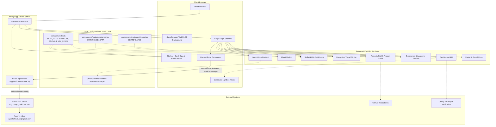
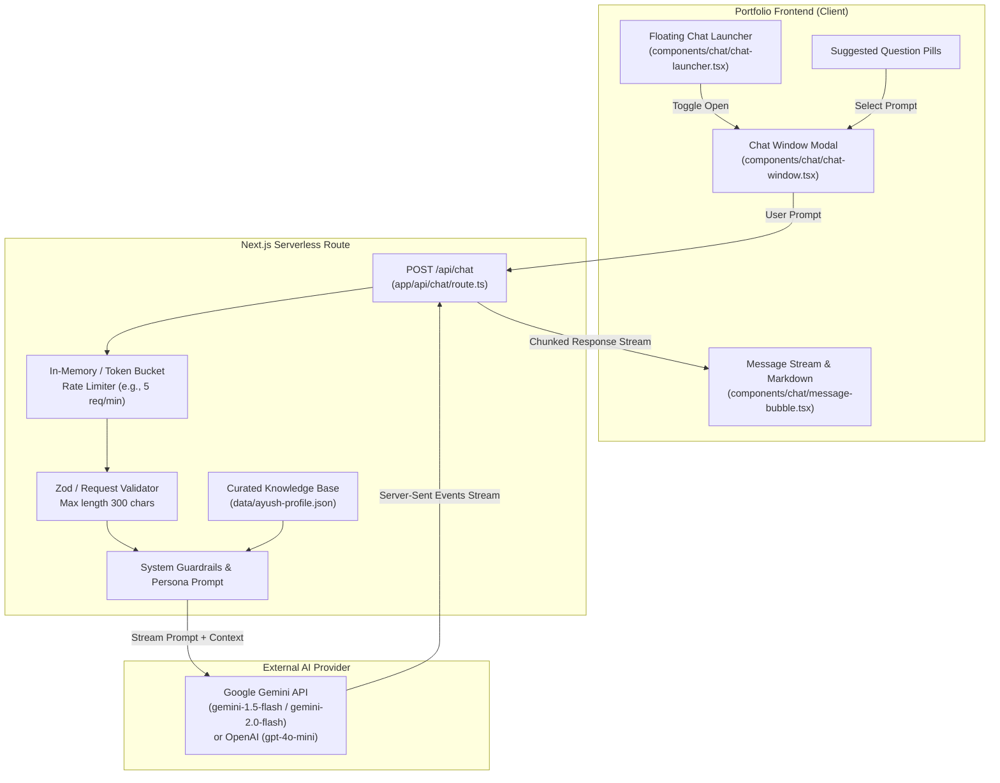
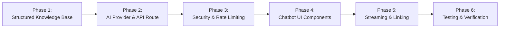

# Codebase Audit Report: Ayush-Space-Portfolio

**Repository:** `Ayush-0915/Ayush-Space-Portfolio`  
**Working Directory:** `c:\Users\ayush\Desktop\Private\Space-Portfolio`  
**Audit Date:** October 14, 2026  
**Auditor:** Antigravity AI Coding Assistant  
**Status:** Read-Only Codebase Audit Completed (No project source code or dependencies modified)  

---

## Table of Contents

1. [Section A: Executive Summary](#section-a-executive-summary)
2. [Section B: Repository Inventory](#section-b-repository-inventory)
3. [Section C: Technology Stack](#section-c-technology-stack)
4. [Section D: Architecture and Data Flow](#section-d-architecture-and-data-flow)
5. [Section E: Feature-by-Feature Analysis](#section-e-feature-by-feature-analysis)
6. [Section F: Personal Knowledge Inventory & Coverage Matrix](#section-f-personal-knowledge-inventory--coverage-matrix)
7. [Section G: API and Backend Analysis](#section-g-api-and-backend-analysis)
8. [Section H: Security and Code Quality Findings](#section-h-security-and-code-quality-findings)
9. [Section I: Chatbot Integration Proposal](#section-i-chatbot-integration-proposal)
10. [Section J: Risks, Dependencies, and Constraints](#section-j-risks-dependencies-and-constraints)
11. [Section K: Recommended Implementation Roadmap](#section-k-recommended-implementation-roadmap)
12. [Section L: Final File Reference Index](#section-l-final-file-reference-index)
13. [Section M: Audit Completeness Statement](#section-m-audit-completeness-statement)

---

## Section A: Executive Summary

### 1. Project Overview
`Ayush-Space-Portfolio` is a modern, single-page personal portfolio website for **Ayush Singh** (full legal name on formal credentials: **Ayush Sanjay Singh**), an AI/ML Engineer and undergraduate student pursuing a Bachelor of Technology in Artificial Intelligence and Machine Learning at Sage University, Indore (Class of 2024–2028).

The web application features an immersive deep-space aesthetic powered by Three.js/WebGL interactive particle canvases, looping celestial background videos, Framer Motion viewport-driven entrance animations, and Tailwind CSS gradients. The site showcases Ayush's machine learning and data science projects, foundational AI/ML toolkits, academic timeline, verifiable cloud/AI certifications, and a serverless contact form backed by Nodemailer.

### 2. Architecture & Current State
The project is built on **Next.js 16.2.4** using the App Router architecture with **React 19.2.5** and **TypeScript 5.9.3**. The application compiles with Turbopack, and the production build produces a static root page (`/`), static error/not-found routes, and a single server-side dynamic API route (`/api/contact`).

Key architectural characteristics:
- **Clean Component Separation:** Code is neatly split into top-level page sections under `components/main/` and reusable subcomponents under `components/sub/`.
- **Hybrid Rendering Model:** The page root (`app/page.tsx`) and layout (`app/layout.tsx`) serve as React Server Components orchestrating client components marked with `'use client'` where browser APIs (canvas, window scroll, forms, modals) are needed.
- **Unified Visual Identity:** Deep space theme (`#030014`), cyan-to-purple gradient highlights (`#06b6d4` to `#7c3aed`), glowing borders, and backdrop blurs.
- **Build & Type Health:** Static type checking (`tsc --noEmit`) passes with **0 errors**. Linting (`eslint .`) passes with **0 errors**. Production build (`next build`) completes successfully in **11.4 seconds**.

### 3. Chatbot Readiness Assessment
The application is in an **excellent position** for integrating an embedded, portfolio-aware AI chatbot.
- **Integration Surface:** A floating launcher widget can be mounted globally inside `app/layout.tsx` without disrupting existing section layouts or 3D canvas rendering.
- **Backend Convention:** Next.js App Router route handlers (`app/api/chat/route.ts`) provide native support for Edge or Node.js runtime streaming with Server-Sent Events (SSE).
- **Knowledge Density:** The repository contains exceptionally detailed, verified personal facts—including complete resume text, project metrics, and six verifiable professional certifications with credential IDs, dates, and issuing authorities.
- **RAG vs. In-Context Injection:** Because the complete verified factual dataset for Ayush spans approximately 2,500 tokens, the initial chatbot **does not require an external vector database or complex RAG pipeline**. It can be grounded directly via a curated, structured JSON knowledge prompt injected server-side, eliminating retrieval latency, vector database costs, and hallucination risks.

---

## Section B: Repository Inventory

The repository contains **167 total files** (excluding `.git`, `node_modules`, and `.next`). Of these, **46 are source code, configuration, or documentation files**, and **121 are static media, images, videos, and document assets**.

```text
Ayush-Space-Portfolio/
├── .env.example                               # SMTP configuration template
├── .eslintrc.json                             # ESLint legacy configuration (extends next/core-web-vitals)
├── .gitignore                                 # Git ignore rules (node_modules, .next, .env*.local)
├── CODE_OF_CONDUCT.md                         # Contributor code of conduct (template upstream)
├── CONTRIBUTING.md                            # Contribution guidelines (template upstream)
├── eslint.config.mjs                          # Modern flat ESLint configuration
├── LICENSE                                    # MIT License (Ayush Singh, 2024)
├── netlify.toml                               # Netlify deployment configuration with build ignore rule
├── next-env.d.ts                              # Next.js TypeScript ambient type declarations
├── next.config.js                             # Next.js configuration object
├── package.json                               # Project metadata, dependencies, and npm scripts
├── package-lock.json                          # Pinned dependency tree (lockfile v3)
├── postcss.config.js                          # PostCSS configuration (tailwindcss, autoprefixer)
├── README.md                                  # Project overview and setup documentation
├── SECURITY.md                                # Security policy document (template placeholder)
├── tailwind.config.ts                         # Tailwind CSS configuration and theme extensions
├── tsconfig.json                              # TypeScript compiler configuration (strict, bundler, paths)
│
├── .github/
│   ├── FUNDING.yml                            # Sponsor configurations (template placeholder)
│   ├── dependabot.yml                         # Weekly npm dependency updates configuration
│   ├── ISSUE_TEMPLATE/
│   │   ├── bug_report.md                      # GitHub issue template: Bug report
│   │   └── feature_request.md                 # GitHub issue template: Feature request
│   ├── images/                                # Upstream template preview images (unreferenced)
│   │   ├── img1.png, img2.png, img3.png, img4.png, img_main.png, stats.svg
│   └── workflows/
│       └── update-readme.yml                  # GitHub Actions workflow: updates README dependencies
│
├── .vscode/
│   └── settings.json                          # VS Code workspace settings (TSDK configuration)
│
├── app/
│   ├── api/
│   │   └── contact/
│   │       └── route.ts                       # Server-side SMTP email dispatch endpoint (Nodemailer)
│   ├── globals.css                            # Tailwind layers, font imports, and custom utility classes
│   ├── layout.tsx                             # Root layout: metadata, Inter font, StarsCanvas, Navbar, Footer
│   ├── page.tsx                               # Single-page index: mounts all 8 portfolio sections
│   ├── apple-icon.png                         # Next.js App Router metadata icon
│   ├── favicon.ico                            # Favicon asset
│   ├── icon1.png, icon2.png                   # Next.js App Router icon metadata assets
│   ├── AWS.jpeg                               # Certificate image: AWS Academy ML Foundations (imported)
│   ├── Gen AI.png                             # Certificate image: Google Cloud Gen AI (imported)
│   ├── Microsoft.png                          # Certificate image: Microsoft Azure Fundamentals (imported)
│   ├── Oracle Certificate.jpg                 # Certificate image: OCI 2025 AI Foundations (imported)
│   ├── Oracle database .jpeg                  # Certificate image: Oracle Academy Database Foundations (imported)
│   ├── Virtual Internship Certificate.jpg     # Certificate image: AICTE / AWS Cloud Virtual Internship (imported)
│   ├── Ayushhh.pdf                            # Duplicate unreferenced resume PDF (identical to public resume)
│   ├── Car Evaluation.png                     # Duplicate unreferenced project preview (identical to public)
│   ├── Netflix Data Analysis.png              # Duplicate unreferenced project preview (identical to public)
│   ├── Shifra.jpg                             # Duplicate unreferenced project preview (identical to public)
│   ├── uber.jpg                               # Duplicate unreferenced project preview (identical to public)
│   └── image.png                              # Duplicate unreferenced portfolio preview (identical to public)
│
├── components/
│   ├── main/
│   │   ├── about.tsx                          # "About Me" introductory bio section
│   │   ├── certificates.tsx                   # Interactive certificate gallery with lightbox modal
│   │   ├── contact.tsx                        # Contact form component with controlled inputs and submit handler
│   │   ├── encryption.tsx                     # Space-themed animated security/performance visual divider
│   │   ├── experience.tsx                     # Academic and project timeline section with vertical line
│   │   ├── footer.tsx                         # Multi-column footer with social, community, and email links
│   │   ├── hero.tsx                           # Hero section wrapper with looping blackhole.webm video
│   │   ├── navbar.tsx                         # Fixed top navbar with scroll-spy, active pill, and mobile drawer
│   │   ├── projects.tsx                       # Responsive grid mapping over PROJECTS dataset
│   │   ├── skills.tsx                         # Consolidated skill icon display with looping skills-bg.webm
│   │   └── star-background.tsx                # Three.js Canvas with 5,000 animated 3D starfield particles
│   └── sub/
│       ├── hero-content.tsx                   # Hero copy, resume CTA, and floating animated orbit skill grid
│       ├── project-card.tsx                   # Individual project card with hover scaling and clamped text
│       ├── skill-data-provider.tsx            # Animated skill icon with viewport trigger and tooltip
│       └── skill-text.tsx                     # Section headers and tagline for the skills section
│
├── config/
│   └── index.ts                               # Site metadata configuration (title, description, keywords)
│
├── constants/
│   └── index.ts                               # Data collections: SKILL_DATA, PROJECTS, SOCIALS, FOOTER_DATA, NAV_LINKS
│
├── lib/
│   ├── motion.ts                              # Reusable Framer Motion animation variant generators
│   └── utils.ts                               # cn() helper combining clsx and tailwind-merge
│
└── public/
    ├── hero-bg.svg                            # Background SVG graphic
    ├── lock-main.png, lock-top.png            # Encryption component graphic assets
    ├── logo.png                               # Navbar brand logo graphic
    ├── projects/                              # Project screenshots and preview cards (11 files)
    │   ├── car-evaluation.png, netflix-dashboard-v2.png, netflix-dashboard.png,
    │   ├── personal-3d-v2.png, personal-3d.png, project-1.png, project-2.png,
    │   ├── project-3.png, shifra.jpg, tips-data-analysis.jpg, uber.jpg
    ├── resume/
    │   └── Updated-Ayush-Resume.pdf           # Downloadable student resume PDF
    ├── skills/                                # Skill icons (80 SVG/PNG files)
    └── videos/                                # Background WebM video loops
        ├── blackhole.webm                     # Hero background celestial loop (739 KB)
        ├── encryption-bg.webm                 # Encryption section visual loop (812 KB)
        └── skills-bg.webm                     # Skills section background visual loop (638 KB)
```

---

## Section C: Technology Stack

Every technology and library has been verified directly against `package.json`, `package-lock.json`, and source code references.

| Technology | Declared Version | Pinned Version | Role in Application | Source Evidence |
| :--- | :--- | :--- | :--- | :--- |
| **Next.js** | `16.2.4` | `16.2.4` | Full-stack framework (App Router, Turbopack, route handlers) | `package.json`, `app/page.tsx`, `next.config.js` |
| **React** | `19.2.5` | `19.2.5` | Core UI library (RSC + Client Components) | `package.json`, `package-lock.json` |
| **React DOM** | `19.2.5` | `19.2.5` | DOM renderer for React | `package.json` |
| **TypeScript** | `^5.9.3` | `5.9.3` | Static typing, interface definitions | `package.json`, `tsconfig.json` |
| **Tailwind CSS** | `^3.3.0` | `3.4.17` | Utility-first styling engine | `tailwind.config.ts`, `app/globals.css` |
| **PostCSS** | `^8` | `8.5.3` | CSS preprocessing and autoprefixing | `postcss.config.js`, `package.json` |
| **Autoprefixer** | `^10.5.0` | `10.4.20` | Vendor prefixing for cross-browser CSS | `postcss.config.js`, `package.json` |
| **Three.js** | `^0.183.2` | `0.183.2` | 3D WebGL scene rendering engine | `package.json`, `components/main/star-background.tsx` |
| **@react-three/fiber** | `^9.6.0` | `9.6.0` | React reconciler for Three.js | `components/main/star-background.tsx` |
| **@react-three/drei** | `^10.7.7` | `10.7.7` | Three.js helpers (`Points`, `PointMaterial`) | `components/main/star-background.tsx` |
| **maath** | *(transitive)* | `0.10.8` | Math helpers (`random.inSphere`) for starfield generation | `components/main/star-background.tsx#L9` |
| **Framer Motion** | `^12.38.0` | `12.38.0` | Declarative UI animations, viewport scroll triggers | `lib/motion.ts`, `components/sub/*.tsx` |
| **Nodemailer** | `^8.0.5` | `8.0.5` | Server-side SMTP email transport | `app/api/contact/route.ts#L2` |
| **Heroicons** | `^2.2.0` | `2.2.0` | Solid SVG icons (`SparklesIcon`) | `components/sub/hero-content.tsx`, `about.tsx` |
| **React Icons** | `^5.6.0` | `5.6.0` | Brand and social icons (`RxGithubLogo`, `FaWhatsapp`, etc.) | `constants/index.ts#L1-L6` |
| **react-intersection-observer** | `^10.0.3` | `10.0.3` | Viewport visibility hooks for deferred animations | `components/sub/skill-data-provider.tsx#L5` |
| **clsx & tailwind-merge** | `^2.1.1` / `^3.5.0` | `2.1.1` / `3.5.0` | Dynamic className composition (`cn()` helper) | `lib/utils.ts`, `app/layout.tsx` |
| **ESLint** | `^9.39.5` | `9.39.5` | Code linting and style enforcement | `eslint.config.mjs`, `.eslintrc.json` |

---

## Section D: Architecture and Data Flow

### 1. Rendering Architecture
The portfolio utilizes Next.js App Router hybrid rendering:
- **Server Component Shell:** `RootLayout` (`app/layout.tsx`) sets global document metadata, injects Google Font `Inter`, sets the page background (`bg-[#030014]`), and composes the application shell.
- **Client Boundaries:** Client-side components are explicitly isolated using the `"use client"` directive. They handle interactive concerns:
  - Three.js WebGL canvas lifecycle (`StarsCanvas`).
  - Scroll-spy navigation, link highlights, and mobile menu toggling (`Navbar`).
  - Viewport-triggered scroll animations (`About`, `Experience`, `HeroContent`, `Skills`).
  - Interactive certificate modal and full-screen image expansion (`Certificates`).
  - Controlled form state, client-side input binding, and asynchronous HTTP calls (`ContactMe`).

### 2. Mermaid Architecture Diagram



### 3. Data Flow Pathways
1. **Initial Page Load:** The server renders the initial HTML for `app/layout.tsx` and `app/page.tsx`. Static visual configurations from `constants/index.ts`, `experience.tsx`, and `certificates.tsx` are compiled into the client bundles.
2. **Animation & Interaction:** Once hydrated in the browser, `framer-motion` animates cards into view as the user scrolls past intersection thresholds (`useInView`), while Three.js executes a `useFrame` render loop rotating 5,000 star points along the x and y axes.
3. **Contact Form Submission:**
   - The user inputs `fullName`, `email`, and `message` in `components/main/contact.tsx`.
   - On submission, `fetch('/api/contact', { method: 'POST', body: JSON.stringify(formData) })` dispatches an asynchronous payload to the server.
   - The server handler in `app/api/contact/route.ts` parses the JSON, validates required fields, initializes a `nodemailer.createTransport`, escapes HTML inputs, and transmits an email via the configured SMTP server.
   - The browser receives `{ message: "Message sent successfully." }` and invokes `alert()`.

---

## Section E: Feature-by-Feature Analysis

### 1. Landing Page & Hero Section
- **Functionality:** Welcomes visitors with animated headings, an "AI ML Engineer Portfolio" badge, an intro paragraph, a direct resume download CTA button, and a floating 3D orbital grid with floating machine learning technology icons. Background features an inverted looping celestial black hole video.
- **Implementation Files:** [hero.tsx](file:///c:/Users/ayush/Desktop/Private/Space-Portfolio/components/main/hero.tsx), [hero-content.tsx](file:///c:/Users/ayush/Desktop/Private/Space-Portfolio/components/sub/hero-content.tsx), [motion.ts](file:///c:/Users/ayush/Desktop/Private/Space-Portfolio/lib/motion.ts).
- **Data Source:** Hardcoded in `hero-content.tsx` (`orbitIcons` array containing Python, TensorFlow, PyTorch, Scikit-learn, Hugging Face, Jupyter, NumPy, Pandas, Matplotlib).
- **Dynamic / Static:** Static client component.
- **Dependencies & Assets:** `/videos/blackhole.webm`, `/resume/Updated-Ayush-Resume.pdf`, Heroicons `SparklesIcon`.

### 2. Navigation & Header
- **Functionality:** Fixed top navigation bar (`h-[65px]`) with backdrop blur. Displays Ayush's logo and name, desktop navigation links, social icons (GitHub, LinkedIn, Instagram, WhatsApp), an active scroll-spy indicator tracking current section position on scroll, and a mobile hamburger menu drawer.
- **Implementation Files:** [navbar.tsx](file:///c:/Users/ayush/Desktop/Private/Space-Portfolio/components/main/navbar.tsx).
- **Data Source:** `NAV_LINKS` and `SOCIALS` exported from [constants/index.ts](file:///c:/Users/ayush/Desktop/Private/Space-Portfolio/constants/index.ts).
- **Dynamic / Static:** Client component with window `scroll` event listener and local state.
- **Dependencies & Assets:** `/logo.png`, `react-icons/rx`, `react-icons/fa`.

### 3. About / Profile Section
- **Functionality:** Brief professional introduction highlighting Ayush as an enthusiastic Machine Learning Engineer focused on AI-driven solutions and practical project development.
- **Implementation Files:** [about.tsx](file:///c:/Users/ayush/Desktop/Private/Space-Portfolio/components/main/about.tsx).
- **Data Source:** Hardcoded copy in `about.tsx`.
- **Dynamic / Static:** Static client component with entry animations.
- **Dependencies & Assets:** Section anchor `id="about-me"`, Framer Motion variants.

### 4. Skills & Technology Stack Section
- **Functionality:** Highlights technical competencies categorized across ML frameworks, data tools, cloud platforms, and databases. Displays skill icons inside animated glowing tiles with hover tooltips and a background celestial video.
- **Implementation Files:** [skills.tsx](file:///c:/Users/ayush/Desktop/Private/Space-Portfolio/components/main/skills.tsx), [skill-data-provider.tsx](file:///c:/Users/ayush/Desktop/Private/Space-Portfolio/components/sub/skill-data-provider.tsx), [skill-text.tsx](file:///c:/Users/ayush/Desktop/Private/Space-Portfolio/components/sub/skill-text.tsx).
- **Data Source:** Flattens `SKILL_DATA`, `FRONTEND_SKILL`, `BACKEND_SKILL`, and `FULLSTACK_SKILL` from [constants/index.ts](file:///c:/Users/ayush/Desktop/Private/Space-Portfolio/constants/index.ts).
- **Dynamic / Static:** Static server component wrapping client icon tiles.
- **Observation / Limitation:** `OTHER_SKILL` (which defines Prompt Engineering with `prompt.svg`) is declared in `constants/index.ts` but omitted from `allSkills` in `skills.tsx`, so it is never displayed on the page.

### 5. Security & Encryption Visual Divider
- **Functionality:** Thematic visual divider featuring an interactive hovering lock graphic, glowing badge, cursive motto ("Secure your data with end-to-end encryption"), and a background video loop.
- **Implementation Files:** [encryption.tsx](file:///c:/Users/ayush/Desktop/Private/Space-Portfolio/components/main/encryption.tsx).
- **Data Source:** Hardcoded copy and static image assets.
- **Dynamic / Static:** Static client component.
- **Dependencies & Assets:** `/lock-top.png`, `/lock-main.png`, `/videos/encryption-bg.webm`.

### 6. Projects Section
- **Functionality:** Responsive 3-column card grid displaying Ayush's projects with preview images, descriptive problem statements, and outbound GitHub/live demo links. Cards feature hover zoom transitions and line-clamped descriptions.
- **Implementation Files:** [projects.tsx](file:///c:/Users/ayush/Desktop/Private/Space-Portfolio/components/main/projects.tsx), [project-card.tsx](file:///c:/Users/ayush/Desktop/Private/Space-Portfolio/components/sub/project-card.tsx).
- **Data Source:** `PROJECTS` array in [constants/index.ts](file:///c:/Users/ayush/Desktop/Private/Space-Portfolio/constants/index.ts).
- **Dynamic / Static:** Static server component rendering individual server-component cards with Next.js `<Image unoptimized>`.
- **Dependencies & Assets:** Section anchor `id="projects"`, image paths under `/projects/`.

### 7. Work Experience & Career Journey
- **Functionality:** Vertical timeline layout displaying Ayush's academic track as a B.Tech AI/ML student at Sage University, Indore, and his ongoing work as an independent AI/ML project developer.
- **Implementation Files:** [experience.tsx](file:///c:/Users/ayush/Desktop/Private/Space-Portfolio/components/main/experience.tsx).
- **Data Source:** `EXPERIENCE_DATA` constant defined directly inside `experience.tsx` (not in `constants/index.ts`).
- **Dynamic / Static:** Static client component with Framer Motion scroll triggers.
- **Dependencies & Assets:** Section anchor `id="experience"`.

### 8. Certificates & Achievements Section
- **Functionality:** Grid of 6 professional and academic certificates. Each card displays the issue year, certificate title, issuing organization, summary of covered topics, and a preview image. Clicking any card opens a responsive, full-screen lightbox modal previewing the high-resolution certificate.
- **Implementation Files:** [certificates.tsx](file:///c:/Users/ayush/Desktop/Private/Space-Portfolio/components/main/certificates.tsx).
- **Data Source:** `CERTIFICATES` array defined directly inside `certificates.tsx`.
- **Dynamic / Static:** Client component with `useState` modal management.
- **Asset Oddity:** Certificate images are imported from `@/app/` rather than `public/`.

### 9. Testimonials Section
- **Status:** **REMOVED / DOES NOT EXIST**.
- **Audit Finding:** While `README.md` still lists "testimonials" among the site features, the implementation file `components/main/testimonials.tsx` was completely deleted in commit `853d989debc065583134399ff16078f9454e3d6a`, and its import was removed from `app/page.tsx`. There is no active testimonials feature in the codebase.

### 10. Contact Form & Flow
- **Functionality:** Form allowing recruiters and collaborators to send messages directly to Ayush. Includes inputs for Full Name, Email, and Message, submit button loading states, and dispatches to `/api/contact`.
- **Implementation Files:** [contact.tsx](file:///c:/Users/ayush/Desktop/Private/Space-Portfolio/components/main/contact.tsx), [route.ts](file:///c:/Users/ayush/Desktop/Private/Space-Portfolio/app/api/contact/route.ts).
- **Data Source:** Client form inputs sent to backend SMTP handler.
- **Dynamic / Static:** Fully dynamic client-server integration.
- **Limitations:** Uses browser native `alert()` for user feedback; missing section anchor `id="contact"`.

### 11. Footer & Social Profiles
- **Functionality:** Multi-column footer displaying Community, Social Media, and About links (GitHub, Instagram, LinkedIn, Direct Email, and pre-composed WhatsApp message link), followed by a copyright notice.
- **Implementation Files:** [footer.tsx](file:///c:/Users/ayush/Desktop/Private/Space-Portfolio/components/main/footer.tsx).
- **Data Source:** `FOOTER_DATA` array in [constants/index.ts](file:///c:/Users/ayush/Desktop/Private/Space-Portfolio/constants/index.ts).
- **Dynamic / Static:** Static server component with dynamic year (`new Date().getFullYear()`).

### 12. Background Effects & 3D Elements
- **Functionality:** Persistent full-viewport 3D starfield canvas rendering 5,000 points randomly distributed inside a sphere with radius 1.2, continuously rotating via Three.js requestAnimationFrame delta time.
- **Implementation Files:** [star-background.tsx](file:///c:/Users/ayush/Desktop/Private/Space-Portfolio/components/main/star-background.tsx), [globals.css](file:///c:/Users/ayush/Desktop/Private/Space-Portfolio/app/globals.css).
- **Dynamic / Static:** Client WebGL canvas mounted inside root layout.

### 13. SEO Metadata & Accessibility
- **Implementation Files:** [config/index.ts](file:///c:/Users/ayush/Desktop/Private/Space-Portfolio/config/index.ts), [app/layout.tsx](file:///c:/Users/ayush/Desktop/Private/Space-Portfolio/app/layout.tsx).
- **Configuration:** Title: "Ayush Singh | Space Portfolio"; theme color: `#030014`.
- **Observation:** Metadata description and keywords still retain outdated Next.js 14 template boilerplate.

---

## Section F: Personal Knowledge Inventory & Coverage Matrix

To enable the future chatbot to accurately represent Ayush, all personal, educational, professional, and credential data was extracted from code constants, component text, and verified binary certificates/resumes.

### 1. Verified Personal Knowledge Details

#### Identity & Contact
- **Full Legal Name:** Ayush Sanjay Singh (from AICTE certificate); professionally known as Ayush Singh.
- **Professional Title:** AI/ML Engineer / Machine Learning Engineer / AI Fresher.
- **Primary Email:** `ayushofficaluse@gmail.com` (verified across resume, commit history, and footer).
- **WhatsApp / Phone:** `+91 9589981849` (WhatsApp pre-filled message: *"Hi Ayush, I visited your portfolio and want to connect."*).
- **GitHub:** `https://github.com/Ayush-0915`
- **LinkedIn:** `https://www.linkedin.com/in/ayush-singh-0915ap`
- **Instagram:** `https://www.instagram.com/ayush_xo._/`
- **Live 3D Portfolio:** `https://ayush-0915.github.io/Personal-3D-Portfolio/`

#### Education & Academic Timeline
- **Degree:** Bachelor of Technology (B.Tech) in Artificial Intelligence and Machine Learning (AI & ML Engineering).
- **Institution:** Sage University, Indore (Madhya Pradesh, India) - NAAC A+ Accredited.
- **Duration / Expected Graduation:** 2024 – 2028 (Currently an active undergraduate student).
- **Academic Focus:** Machine Learning, Deep Learning, Data Science, Computer Vision, Natural Language Processing, Predictive Analytics, and SQL/Databases.

#### Verifiable Certifications & Badges (Exact IDs & Details)
1. **AI-Powered Cloud Engineer Virtual Internship (10 Weeks)**
   - *Issuers:* AICTE (Ministry of Education, Gov. of India) & EduSkills Foundation in partnership with AWS Educate.
   - *Duration:* January 2026 – March 2026.
   - *Grade Awarded:* **O (Outstanding)** (90–100 score bracket).
   - *Certificate ID:* `4cc197054f0ee13365f9` | *Student ID:* `STU696de12b5ea621768808747`.
2. **Microsoft Certified: Azure Fundamentals (AZ-900)**
   - *Issuer:* Microsoft.
   - *Issue Date:* June 27, 2025.
   - *Verification Code:* `verify.certiport.com: 2Q6n-XMSn`.
3. **Google Cloud Career Launchpad: Generative AI Leader Track**
   - *Issuer:* Google Cloud Learning Services (Erin Rifkin, Managing Director).
   - *Issue Date:* April 9, 2026 (Lifetime validity).
   - *Certificate ID:* `YHnL2kPx`.
4. **Oracle Cloud Infrastructure 2025 Certified AI Foundations Associate**
   - *Issuer:* Oracle University (Damien Carey, SVP).
   - *Issue Date:* November 2, 2025.
   - *Certificate ID:* `103066510OCI25AICFA`.
5. **Database Foundations – English (Award of Completion)**
   - *Issuer:* Oracle Academy in partnership with Sage University Indore.
   - *Issue Date:* November 30, 2025.
   - *Instructor:* Vijay Malviya.
6. **AWS Academy Graduate: Machine Learning Foundations (Training Badge)**
   - *Issuer:* AWS Academy.
   - *Course Duration:* 20 hours.
   - *Issue Date:* 12/01/2025.
   - *Digital Badge URL:* `https://www.credly.com/go/DdDalQpN`.

#### Individual Projects Breakdown
1. **Car Evaluation Using Decision Tree Classifier**
   - *Objective:* Predict vehicle acceptability based on categorical attributes (safety, cost, doors, seating capacity).
   - *Algorithm / Tech:* Python, Scikit-learn Decision Tree (Gini Index criterion), Power BI visualization.
   - *Verified Metrics:* **82% accuracy, 86% precision, 85% recall**. Identified "safety" as the most critical predictive feature.
   - *Repository:* `https://github.com/Ayush-0915/Car-evaluation`.
2. **Shifra 2.0 – Basic Voice Assistant**
   - *Objective:* AI-driven desktop conversational voice assistant with seamless natural voice interaction.
   - *Tech Stack:* Python, Speech-to-Text (STT), Text-to-Speech (TTS), and **Google Gemini API** integration for contextual reasoning.
   - *Repository:* `https://github.com/Ayush-0915/Shifra-2.O`.
3. **Netflix Data Analysis Dashboard**
   - *Objective:* Comprehensive Exploratory Data Analysis (EDA) on Netflix title catalog to discover release patterns, content type ratios, and international distribution trends.
   - *Tech Stack:* Python, Pandas, Matplotlib, Seaborn, Power BI.
   - *Repository:* `https://github.com/Ayush-0915/Netflix-Data-Analysis`.
4. **Uber Trip Insights Dashboard**
   - *Objective:* Operational analytics on ride-sharing trip logs to identify peak demand hours, surge pricing clusters, and geographical trip volumes.
   - *Tech Stack:* Python, Power BI.
   - *Repository:* `https://github.com/Ayush-0915/Uber-Data-Analysis`.
5. **Personal 3D Portfolio**
   - *Objective:* Interactive 3D web experience showcasing projects, skills, and resume.
   - *Tech Stack:* Three.js, React, HTML/CSS, GitHub Pages.
   - *Live Deployment:* `https://ayush-0915.github.io/Personal-3D-Portfolio/`.
6. **Tips Data Analysis**
   - *Objective:* End-to-end exploratory analysis analyzing restaurant tipping dynamics across total bill amounts, party sizes, meal times, and smoking preferences.
   - *Tech Stack:* Python, Pandas, Seaborn, Matplotlib.
   - *Repository:* `https://github.com/Ayush-0915/Tips-Data-Analysis`.

---

### 2. Knowledge Coverage Matrix

| Category | Status | Authoritative Source File(s) | Verified Facts vs. Identified Gaps |
| :--- | :--- | :--- | :--- |
| **Identity & Bio** | **Well Documented** | `Updated-Ayush-Resume.pdf`, `hero-content.tsx`, `about.tsx` | Verified name, education, career objective. |
| **Education Details** | **Well Documented** | `Updated-Ayush-Resume.pdf`, `experience.tsx`, `Oracle database .jpeg` | B.Tech AI/ML (2024–2028), Sage University Indore. |
| **Technical Skills** | **Well Documented** | `constants/index.ts`, `Updated-Ayush-Resume.pdf` | Python, Scikit-learn, PyTorch, TensorFlow, Pandas, NumPy, Power BI, MySQL, Git, Docker, AWS, GCP. |
| **Certifications** | **Exhaustively Documented** | `app/*.jpeg/png/jpg`, `certificates.tsx`, `Updated-Ayush-Resume.pdf` | All 6 credentials verified with exact issuing bodies, dates, and credential IDs. |
| **Individual Projects** | **Well Documented** | `Updated-Ayush-Resume.pdf`, `constants/index.ts` | 6 projects with descriptions, GitHub links, and specific metrics (accuracy/features) for key models. |
| **Contact Channels** | **Well Documented** | `constants/index.ts`, `footer.tsx`, `Updated-Ayush-Resume.pdf` | Email, WhatsApp phone, GitHub, LinkedIn, Instagram verified. |
| **Career Interests** | **Partially Documented**| `Updated-Ayush-Resume.pdf`, `about.tsx` | Explicitly seeking Machine Learning / Data Analyst internships; specific industry domain preferences not detailed. |
| **Hackathons / Competitions** | **Partially Documented**| `components/main/experience.tsx` | Mentioned as actively participating, but specific event names, placement, or dates are not documented in the repository. |
| **Work / Job History** | **Partially Documented**| `components/main/experience.tsx`, `Virtual Internship Certificate.jpg` | Virtual Internship completed (AI-Powered Cloud Engineer); no traditional corporate employment history (expected for undergraduate student). |
| **Testimonials** | **Missing / Deleted** | N/A (`testimonials.tsx` deleted) | No peer or client testimonials exist in active code. |

---

## Section G: API and Backend Analysis

### 1. Existing Endpoints
The application possesses exactly one API route:
- **Route:** `POST /api/contact`
- **Source File:** [app/api/contact/route.ts](file:///c:/Users/ayush/Desktop/Private/Space-Portfolio/app/api/contact/route.ts)
- **Runtime Target:** Node.js (`export const runtime = "nodejs";` required for Nodemailer socket transports).

### 2. Request Handling & Validation
```typescript
const body = await request.json();
const fullName = String(body?.fullName ?? "").trim();
const email = String(body?.email ?? "").trim();
const message = String(body?.message ?? "").trim();

if (!fullName || !email || !message) {
  return NextResponse.json({ message: "All fields are required." }, { status: 400 });
}
```
**Findings on Validation:**
- Only checks that strings are non-empty after trimming.
- **No email format verification:** An invalid email like `foo@bar` or `abc` is accepted and passed directly to Nodemailer.
- **No length bounds:** Payloads with megabytes of text in `message` or `fullName` are not rejected, posing a memory consumption risk.
- **HTML Sanitization:** Implements custom regex string replacement escaping `&`, `<`, `>`, `"`, and `'`.

### 3. SMTP Transport Configuration
- Reads: `SMTP_HOST`, `SMTP_PORT` (default 587), `SMTP_USER`, `SMTP_PASS`, `MAIL_TO`, `MAIL_FROM`, `SMTP_SECURE`.
- Missing required variables trigger an error caught by the generic catch block.
- In development (`NODE_ENV !== "production"`), internal configuration error messages are reflected back to the client (`status: 500`). In production, a generic error message is returned.

### 4. Abuse Prevention & Security
- **No Rate Limiting:** The endpoint lacks any IP-based or session-based rate limiting. An automated bot can flood the endpoint, exhausting SMTP quotas or triggering mail provider abuse suspensions.
- **No Bot Protection:** No CAPTCHA or hidden honeypot fields exist on the client form or route handler.

---

## Section H: Security and Code Quality Findings

### 1. Severity Ranking Table

| Finding | Severity | Category | Affected File(s) | Impact & Recommendation |
| :--- | :--- | :--- | :--- | :--- |
| **21 Known Vulnerabilities in Dependencies** | **Critical / High** | Dependencies | `package.json`, `package-lock.json` | `npm audit` reports 21 vulnerabilities (13 High, 1 Critical): Nodemailer (CRLF injection / SSRF), Next.js 16.2.4 security advisories, PostCSS, and Sharp. Run controlled updates after regression testing. |
| **Unbounded / Un-rate-limited Contact Endpoint** | **High** | API Security | `app/api/contact/route.ts` | Allows unlimited POST requests, opening risks for mail server exhaustion, email flooding, and denial of service. Implement rate limiting and input length bounds. |
| **Incomplete `.gitignore` for `.env`** | **Medium** | Secret Hygiene | `.gitignore#L29` | `.gitignore` specifies `.env*.local`, but does not ignore plain `.env`. If a contributor creates `.env`, secrets could be accidentally committed. Add `.env` to `.gitignore`. |
| **Transitive / Phantom Dependency (`maath`)** | **Medium** | Build Health | `components/main/star-background.tsx#L9` | `star-background.tsx` imports from `maath/random`, but `maath` is not declared in `package.json`. Add `"maath": "^0.10.8"` directly to dependencies. |
| **Template Residue & Author Inconsistencies** | **Medium** | Code Quality | `package.json`, `config/index.ts`, `constants/index.ts`, `.github/FUNDING.yml` | Several files still link to upstream template author `sanidhyy` or placeholders like `https://github.com/ayush` and `ayush.singh@example.com`. Update to Ayush's real details. |
| **Redundant Binary Files in `app/` (7+ MB)** | **Low** | Repository Bloat | `app/` root directory | Seven duplicate media/PDF files exist directly in `app/` identical to files in `public/` (Car Evaluation.png, Netflix Data Analysis.png, Shifra.jpg, uber.jpg, image.png, Ayushhh.pdf). Clean up unused duplicates. |
| **Dead Exports in `constants/index.ts`** | **Low** | Code Hygiene | `constants/index.ts#L140, #L264` | `OTHER_SKILL` (Prompt Engineering) and `LINKS` are exported but never imported anywhere in the project. |
| **Missing Form Anchor & Primitive `alert()`** | **Low** | User Experience | `components/main/contact.tsx` | Contact section lacks `id="contact"`, making it unreachable via direct hash links. The form relies on blocking browser `alert()` calls rather than toast notifications. |
| **Zero Automated Test Coverage** | **Low** | Testing Health | Repository root | No test runner (Jest, Vitest, Playwright) or test specifications exist. |

---

## Section I: Chatbot Integration Proposal

### 1. Target User Experience
Visitors will interact with a sleek, non-intrusive floating chat widget situated at the bottom-right of the screen. Clicking the launcher opens a cyber-styled chat window matching the space palette (`#030014`, cyan-400 borders, translucent dark purple surfaces).

Visitors can ask questions in natural language:
- *"Who is Ayush Singh?"*
- *"Explain his Car Evaluation project and what accuracy he achieved."*
- *"What certifications does he hold in AI and Cloud?"*
- *"What is his educational background?"*
- *"How can I get in touch with Ayush or message him on WhatsApp?"*

### 2. Proposed Architecture Diagram



### 3. Key Design Decisions

#### Why In-Context Grounding Beats RAG for this Portfolio
- **Dataset Size:** Ayush's verified portfolio facts, project metrics, education history, and certifications total roughly **2,000–2,500 tokens**.
- Modern small models (e.g., `gemini-1.5-flash` or `gpt-4o-mini`) have context windows of 128k to 1M+ tokens.
- Injecting the complete structured knowledge base directly into the system instructions guarantees **zero retrieval failure**, avoids vector database subscriptions (Pinecone/Weaviate), eliminates cold-start latency, and provides 100% factual grounding with strict negative guardrails.

#### Strict Anti-Hallucination Guardrails
The system prompt will instruct the model:
1. *"You are the AI portfolio assistant for Ayush Singh, an AI/ML Engineer and B.Tech student at Sage University, Indore."*
2. *"Only state verified facts provided in your knowledge context. If a user asks about projects, grades, or personal details not in your context, respond politely: 'I do not have verified information on that, but you can reach out to Ayush directly at ayushofficaluse@gmail.com.'"*
3. *"Never invent hackathon placements, unverified job roles, or technologies Ayush has not worked with."*
4. *"When describing projects or social profiles, provide clickable Markdown links (e.g., [Car Evaluation on GitHub](https://github.com/Ayush-0915/Car-evaluation))."*

#### Frontend & Visual Integration
- Place `<ChatLauncher />` inside `app/layout.tsx` so it renders across the site.
- Use Tailwind classes `z-50 fixed bottom-6 right-6` with Framer Motion spring pop-up animations.
- Support markdown rendering (`react-markdown`) for bullet points and links with sanitized HTML.

#### Rate Limiting & Safety
- **Request Cap:** Max 300 characters per message; max 10 messages per user session.
- **Rate Limit:** 5 requests per minute per IP address.
- **Environment Key:** `GEMINI_API_KEY` or `OPENAI_API_KEY` stored exclusively server-side in `.env.local` (never exposed with `NEXT_PUBLIC_`).

---

## Section J: Risks, Dependencies, and Constraints

1. **Dependency Incompatibility (React 19 & Next 16):**
   - React 19 and Next.js 16 are very new. Some popular third-party chatbot wrapper libraries (like older versions of `@ai-sdk/react` or certain markdown libraries) may have peer dependency conflicts with React 19. Using direct Fetch SSE streams or verified React 19-compatible SDKs is essential.
2. **Hosting Provider Execution Limits:**
   - On Netlify or Vercel serverless free tiers, HTTP streaming responses have default function timeout limits (10s to 30s). The model selected must have fast Time-To-First-Token (TTFT) like `gemini-1.5-flash` to prevent gateway timeouts.
3. **Public API Key Exhaustion:**
   - An unprotected chat route can be abused by automated bots to burn through API quotas. Strict server-side rate limiting and input length validation are mandatory before going live.
4. **Missing Personal Data Details:**
   - Specific hackathon achievements and corporate internship histories are not yet detailed in the repository. The chatbot's prompt must explicitly handle these gaps gracefully.

---

## Section K: Recommended Implementation Roadmap



### Phase 1: Compile the Structured Knowledge Base
- Create `data/ayush-profile.json` consolidating all verified facts extracted during this audit (education, skills, project metrics, certificate IDs, contact links, and fallback responses).

### Phase 2: Implement the Server-Side Route (`/api/chat`)
- Create `app/api/chat/route.ts` using the Node.js or Edge runtime.
- Integrate the AI provider client (e.g., `@google/genai` or `ai` SDK) using a server-side environment key (`GEMINI_API_KEY`).
- Return a streaming response via Server-Sent Events (SSE).

### Phase 3: Add Security, Validation, and Rate Limiting
- Add input validation schema (check message length <= 300 characters, sanitize control characters).
- Add lightweight in-memory or Redis-based rate limiting (5 requests/minute per client IP).

### Phase 4: Build the Chatbot Interface Components
- Create `components/chat/chat-launcher.tsx` (floating toggle button).
- Create `components/chat/chat-window.tsx` (conversation dialog, header, suggestion chips, input field, and auto-scrolling message list).
- Match the `#030014` space theme and Framer Motion spring transitions.

### Phase 5: Support Streaming, Markdown, and Clickable Action Links
- Connect the frontend input to the SSE stream so assistant responses render smoothly token-by-token.
- Render clean Markdown with clickable GitHub and project links.

### Phase 6: Edge Case Testing, Verification, and Deployment
- Test question sets: identity, skills, projects, certificate verification codes, contact details, out-of-scope refusals, and malicious prompt injections.
- Run `npm run build` and test production bundle execution before pushing to GitHub.

---

## Section L: Final File Reference Index

### 1. Existing Core Files & Responsibilities

| File Path | Role & Content | Chatbot Impact |
| :--- | :--- | :--- |
| [app/layout.tsx](file:///c:/Users/ayush/Desktop/Private/Space-Portfolio/app/layout.tsx) | Root application layout, font injection, global shell | **Modify**: Mount `<ChatLauncher />` here |
| [app/page.tsx](file:///c:/Users/ayush/Desktop/Private/Space-Portfolio/app/page.tsx) | Single-page section orchestrator | No changes required |
| [app/api/contact/route.ts](file:///c:/Users/ayush/Desktop/Private/Space-Portfolio/app/api/contact/route.ts) | Existing Nodemailer contact form endpoint | Reference for backend route conventions |
| [components/main/navbar.tsx](file:///c:/Users/ayush/Desktop/Private/Space-Portfolio/components/main/navbar.tsx) | Top navigation bar with scroll-spy | No changes required |
| [components/main/experience.tsx](file:///c:/Users/ayush/Desktop/Private/Space-Portfolio/components/main/experience.tsx) | Education & developer timeline | Reference for chatbot knowledge |
| [components/main/certificates.tsx](file:///c:/Users/ayush/Desktop/Private/Space-Portfolio/components/main/certificates.tsx) | Interactive certificate gallery | Reference for credential verification data |
| [constants/index.ts](file:///c:/Users/ayush/Desktop/Private/Space-Portfolio/constants/index.ts) | Projects, skills, socials, and nav data | Reference for projects & social URLs |
| [public/resume/Updated-Ayush-Resume.pdf](file:///c:/Users/ayush/Desktop/Private/Space-Portfolio/public/resume/Updated-Ayush-Resume.pdf) | Authoritative source of academic and project metrics | Reference for chatbot grounding |

### 2. Proposed Files for Chatbot Implementation Phase

| Proposed File Path | Intended Purpose |
| :--- | :--- |
| `data/ayush-profile.json` | Centralized, machine-readable personal knowledge base |
| `app/api/chat/route.ts` | Server-side streaming AI route handler |
| `components/chat/chat-launcher.tsx` | Floating launcher button with badge and sound/click triggers |
| `components/chat/chat-window.tsx` | Main chat dialog with streaming response handler and suggested pills |
| `components/chat/chat-message.tsx` | Formatted chat bubble with Markdown support and project links |

---

## Section M: Audit Completeness Statement

1. **Total Relevant Files Discovered:** 168 files discovered in repository (167 files after cleaning temporary build-generated `.tsbuildinfo`).
2. **Files Intentionally Excluded from Deep Reading:**
   - `.git` internal database (object files and commit refs).
   - `.next` build output and caching directories.
   - `node_modules` package files (except targeted inspection of transitive `maath`).
   - 121 binary media files (images, SVGs, WebM videos, and PDFs were cataloged; key certificates and resume PDFs were directly viewed and verified via visual OCR tools).
3. **Source / Configuration / Documentation Files Fully Inspected:** 46 files examined line-by-line across root, `app/`, `components/`, `config/`, `constants/`, `lib/`, and `.github/`.
4. **Commands Executed & Verified Results:**
   - `tsc --noEmit` / `.\node_modules\.bin\tsc.cmd --noEmit`: **Success (Exit code 0)**. Zero type errors.
   - `npm run lint` (`eslint .`): **Success (Exit code 0)**. Zero lint warnings or errors.
   - `npm run build` (`next build`): **Success (Exit code 0)**. Compiled successfully with Turbopack in 11.4s; all static routes and dynamic API routes generated properly.
   - `npm audit`: **Warning (Exit code 1)**. 21 vulnerabilities identified (1 low, 6 moderate, 13 high, 1 critical) in transitive/direct packages (Nodemailer, Next.js, PostCSS, Sharp).
5. **Accessibility Limitations:** All files in the repository workspace were accessible without permission or filesystem errors.
6. **Integrity Confirmation:** Zero project source files, dependencies, configurations, or lockfiles were modified, deleted, or reformatted during this audit. Only this markdown audit report was generated.
