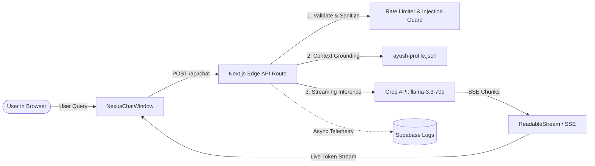

# Ayush Singh — Space Portfolio

<p align="center">
  <strong>AI/ML Engineer crafting intelligent systems, predictive pipelines, and computer vision architectures.</strong>
</p>

<p align="center">
  <a href="https://ayush-space-portfolio.vercel.app">
    
  </a>
  <a href="https://github.com/Ayush-0915/Space-Portfolio">
    
  </a>
</p>

<p align="center">
  
  
  
  
  
  
  
  
</p>

---

## Portfolio Overview


---

## Table of Contents

- [About the Project](#about-the-project)
- [Key Features](#key-features)
- [Featured Projects](#featured-projects)
- [Work Experience and Hackathons](#work-experience-and-hackathons)
- [Technology Stack](#technology-stack)
- [Nexus AI Architecture](#nexus-ai-architecture)
- [Project Structure](#project-structure)
- [Getting Started](#getting-started)
- [Environment Configuration](#environment-configuration)
- [Professional Links and Contact](#professional-links-and-contact)
- [License](#license)

---

## About the Project

This repository hosts the source code for my personal space-themed portfolio as an **AI/ML Engineer** and undergraduate researcher pursuing a Bachelor of Technology in Artificial Intelligence and Machine Learning at **Sage University, Indore**.

The portfolio is designed as an immersive, technically credible platform that reflects modern software engineering standards while showcasing my real-world focus in:
- Supervised machine learning algorithms, decision trees, and statistical modeling.
- End-to-end data pipelines, exploratory data analysis (EDA), and business intelligence dashboards.
- Applied computer vision and geospatial environmental analysis.
- National-level competitive hackathons (**Smart India Hackathon 2026** and **AGNITIA '26**).
- An interactive, context-grounded AI conversational agent (**Nexus AI**).

---

## Key Features

### 🌌 Immersive Space-Themed Hero Section
- Dynamic celestial environment with an atmospheric blackhole video backdrop, canvas particle starfield rendered via Three.js (`@react-three/fiber`), and a fixed glassmorphic navigation bar.
- Recruiter availability beacon (*"Available for AI/ML Opportunities"*) paired with quick actions for project exploration and direct resume download.

### 🪐 Nexus Core Orbital AI Visualization
- Bespoke Gen-Z AI universe featuring an SVG multi-stop radial energy core, asymmetric tilted luminous orbits, and dynamic traveling neon pulse streams.
- HUD telemetry readouts, geographic coordinates (`+ N 28.7041° / E 77.1025°`), celestial satellites, and interactive floating glass technology chips for **Python**, **Scikit-learn**, **FastAPI**, and **PyTorch**.

### 👤 Two-Column About Me & Technical Focus
- Personal first-person narrative preserving verified academic background and core areas of investigation.
- Core Specializations pill matrix covering *Machine Learning*, *Predictive Modeling*, *Computer Vision*, *Data Analysis & EDA*, *Python & PyTorch*, and *FastAPI & Architecture*.
- Three compact visual profile cards highlighting:
  1. **AI & Machine Learning**: Model development, predictive modeling, and ML pipelines.
  2. **Applied Engineering**: Computer vision, data analysis, and software systems.
  3. **Research & Hackathons**: Practical experimentation and collaborative problem-solving.

### 💼 Responsive Horizontal Project Cards
- Modular 3-column desktop layout (`30% preview image` | `flexible technical narrative & tags` | `metadata column with GitHub links & verified completion dates`).
- Graceful tablet compression and mobile vertical card stacking with zero layout clipping or horizontal overflow.

### 🤖 Grounded Nexus AI Conversational Agent
- Low-latency chat interface powered by Groq (`llama-3.3-70b-versatile`) utilizing **Server-Sent Events (SSE)** for real-time word-by-word streaming.
- Grounded strictly in an authoritative structured knowledge base (`data/ayush-profile.json`) to prevent hallucinations and accurately answer questions about Ayush's skills, hackathons, projects, and contact info.
- Session logging with Supabase, client-side rate limiting, prompt injection defenses, and graceful offline fallback.

### 🔤 Art-Directed Typography System
- Engineered around three complementary typefaces loaded via `next/font/google`:
  - **Space Grotesk** (`font-heading`): Headlines, section titles, card headers, and brand labels.
  - **Inter** (`font-sans`): Body copy, technical descriptions, navigation, and dialog text.
  - **JetBrains Mono** (`font-mono`): Telemetry coordinates, dates, categories, badges, and code blocks.
- 100% self-hosted at build time with `display: 'swap'` — eliminates external Google Fonts runtime network requests and prevents Cumulative Layout Shift (CLS).

### ♿ Accessibility & Motion Preferences
- Complete `@media (prefers-reduced-motion: reduce)` and Framer Motion `useReducedMotion()` integration across all animated components, replacing infinite rotations and translates with instant fades.

---

## Featured Projects

All projects below reflect real, verified repositories and implementations:

| Project | Domain | Stack | Period | Links |
| :--- | :--- | :--- | :--- | :--- |
| **Car Evaluation Classifier** | Machine Learning & Classification | Python, Scikit-learn, Decision Trees, Pandas, Matplotlib | Apr 2026 | [GitHub Repo](https://github.com/Ayush-0915/Car-Evaluation-Decision-Tree) |
| **Personal 3D Space Portfolio** | Interactive 3D & Web Graphics | Three.js, React, Vite, Tailwind CSS, WebGL | Apr 2026 | [GitHub Repo](https://github.com/Ayush-0915/Personal-3D-Portfolio) · [Live Demo](https://ayush-0915.github.io/Personal-3D-Portfolio/) |
| **Uber Trip Insights Dashboard** | Operational Analytics & BI | Power BI, Python, DAX, Exploratory Data Analysis | Jan 2026 | [GitHub Repo](https://github.com/Ayush-0915/Uber-Data-Analysis) |
| **Tips Data Analysis & Modeling** | Statistical EDA & Analytics | Python, Pandas, Seaborn, Matplotlib, Statistics | Nov 2025 | [GitHub Repo](https://github.com/Ayush-0915/tips-data-analysis) |
| **Shifra 2.0 AI Assistant** *(Prototype)* | Conversational AI & Speech | Python, SpeechRecognition, pyttsx3, Web Automation | Jul 2025 | [GitHub Repo](https://github.com/Ayush-0915/shifra2.0) |
| **Netflix Data Analysis Dashboard** | Exploratory Data Analysis & BI | Power BI, Microsoft Excel, Data Visualization, DAX | Jun 2025 | [GitHub Repo](https://github.com/Ayush-0915/Netflix-Data-Analysis) |

---

## Work Experience and Hackathons

### 🏆 AGNITIA '26 National-Level Hackathon — 5th Place
- **Host**: Prestige Institute of Engineering Management and Research (PIEMR), Indore · *October 2026*
- **Team**: Team DeveloperX · **Track**: TERRA02 (Industrial Pollution Source Attribution Engine)
- **Project**: **Air Kavach** ([Repository](https://github.com/Afsar426/-AIR-KAVACH))
- **Role**: Deployment & Technical Documentation
- **Key Contributions**:
  - Engineered deployment preparations and system architecture documentation for an environmental intelligence engine combining ambient air monitoring, wind transport vectors, and geospatial facility screening.
  - Documented forensic investigative workflows and mathematical baseline attribution models.
  - Supported the live demonstration of the environmental AI platform during the 36-hour hackathon.

### 🛰️ Smart India Hackathon (SIH) 2026 — Qualified Competitor
- **Host**: Ministry of Education's Innovation Cell & AICTE · *October 2026*
- **Organization**: Indian Space Research Organisation (ISRO) · **Problem ID**: SIH26167
- **Team**: Team Cognitive Crafters · **Project**: **SatQuery AI**
- **Role**: Machine Learning & AI Engineering Contributor
- **Key Contributions**:
  - Contributed to conversational query processing for multi-sensor Indian Earth observation satellite metadata (Cartosat, Resourcesat, Oceansat).
  - Designed natural-language query routing mechanisms for geospatial metadata retrieval.

---

## Technology Stack

```text
┌────────────────────────────────────────────────────────────────────────┐
│                          PORTFOLIO TECH STACK                          │
├───────────────────────┬────────────────────────────────────────────────┤
│ Core Framework        │ Next.js 16.2.4 (App Router, Turbopack)         │
│ UI Library            │ React 19.2.5, React DOM 19.2.5                 │
│ Language              │ TypeScript 5.9.3                               │
│ Styling               │ Tailwind CSS 3.3.0, PostCSS, Autoprefixer      │
│ 3D & Graphics         │ Three.js 0.183.2, @react-three/fiber, drei     │
│ Animations            │ Framer Motion 12.38.0                          │
│ AI Chatbot Engine     │ Groq SDK 1.6.0 (llama-3.3-70b-versatile via SSE│
│ Database & Logging    │ Supabase JS 2.117.3                            │
│ Email Delivery        │ Nodemailer 8.0.5 (SMTP transport)              │
│ Icons                 │ @heroicons/react 2.2.0, react-icons 5.6.0      │
│ Deployment            │ Vercel Edge Network                            │
└───────────────────────┴────────────────────────────────────────────────┘
```

---

## Nexus AI Architecture

The portfolio includes an embedded, autonomous conversational agent called **Nexus AI**:



- **Grounding Rules**: The system prompt enforces strict grounding in `data/ayush-profile.json`. The model explicitly declines ungrounded queries and never hallucinates metrics or unpublished credentials.
- **Resilience**: Operates in mock/fallback mode when environment variables are omitted, ensuring local development remains frictionless.

---

## Project Structure

```text
Space-Portfolio/
├── app/
│   ├── api/
│   │   ├── chat/route.ts        # Streaming Nexus AI chatbot endpoint (Groq + SSE)
│   │   └── contact/route.ts     # SMTP contact form email handler
│   ├── globals.css              # Custom keyframes, typography rules, & media queries
│   ├── layout.tsx               # Root layout, Google font variables, & starfield canvas
│   └── page.tsx                 # Single-page layout assembling all portfolio sections
├── components/
│   ├── chat/                    # Nexus AI chat window, message list, & floating launcher
│   ├── main/                    # Primary sections: Hero, About, Skills, Projects, Experience...
│   └── sub/                     # Granular UI elements: NexusCoreVisual, ProjectCard, SkillText...
├── constants/
│   └── index.ts                 # Authoritative data for projects, skills, and navigation
├── data/
│   └── ayush-profile.json       # Grounded knowledge base for Nexus AI chatbot
├── lib/
│   ├── motion.ts                # Reusable Framer Motion animation variants
│   ├── profile.ts               # Typed loader and validation for ayush-profile.json
│   └── supabase.ts              # Supabase client instantiation and telemetry helpers
├── public/
│   ├── images/                  # Clean hero section screenshot (portfolio-hero.png)
│   ├── projects/                # Screenshots and dashboard previews for project cards
│   ├── resume/                  # Updated-Ayush-Resume.pdf
│   ├── skills/                  # SVG and PNG technology logos
│   └── videos/                  # blackhole.webm, encryption-bg.webm, skills-bg.webm
└── tailwind.config.ts           # Tailwind configuration & typography extensions
```

---

## Getting Started

### Prerequisites

- **Node.js**: `v20.9.0` or higher (tested on Node 20 & 24)
- **Package Manager**: `npm` (v10+)

### 1. Clone the Repository

```bash
git clone https://github.com/Ayush-0915/Space-Portfolio.git
cd Space-Portfolio
```

### 2. Install Dependencies

```bash
npm install
```

### 3. Run the Development Server

```bash
npm run dev
```

Open [http://localhost:3000](http://localhost:3000) in your browser.

### 4. Build for Production

```bash
npm run build
npm run start
```

### 5. Linting and Validation

```bash
npm run lint
npx tsc --noEmit
```

---

## Environment Configuration

The portfolio works fully out-of-the-box in local development with no required environment variables. However, if you wish to enable the live Groq streaming chatbot, Supabase telemetry, or the contact form, copy the example environment file:

```bash
cp .env.example .env.local
```

Configure your credentials in `.env.local`:

```env
# AI Chatbot Engine (Optional - chatbot uses fallback mode if omitted)
GROQ_API_KEY=your_groq_api_key_here

# Telemetry & Chat Logs (Optional)
NEXT_PUBLIC_SUPABASE_URL=https://your-project.supabase.co
NEXT_PUBLIC_SUPABASE_ANON_KEY=your_supabase_anon_key
SUPABASE_SERVICE_ROLE_KEY=your_supabase_service_role_key

# Contact Form Email (Optional - needed only for contact form submissions)
SMTP_HOST=smtp.gmail.com
SMTP_PORT=587
SMTP_USER=your_email@gmail.com
SMTP_PASS=your_app_password
MAIL_TO=your_email@gmail.com
MAIL_FROM=your_email@gmail.com
```

> **Security Note:** Never commit your `.env.local` file or expose private API keys. Both `GROQ_API_KEY` and `SUPABASE_SERVICE_ROLE_KEY` are server-only credentials handled exclusively in Next.js Edge / Node API routes.

---

## Professional Links and Contact

- **Live Website**: [ayush-space-portfolio.vercel.app](https://ayush-space-portfolio.vercel.app)
- **GitHub**: [@Ayush-0915](https://github.com/Ayush-0915)
- **LinkedIn**: [Ayush Singh](https://www.linkedin.com/in/ayush-singh-0915ap)
- **Instagram**: [@ayush_xo._](https://www.instagram.com/ayush_xo._/)
- **WhatsApp**: [+91 9589981849](https://wa.me/919589981849)
- **Email**: [ayushofficaluse@gmail.com](mailto:ayushofficaluse@gmail.com)
- **Resume**: Direct PDF download available from the hero section or `/resume/Updated-Ayush-Resume.pdf`.

---

## License

This project is open source and available under the [MIT License](LICENSE).
